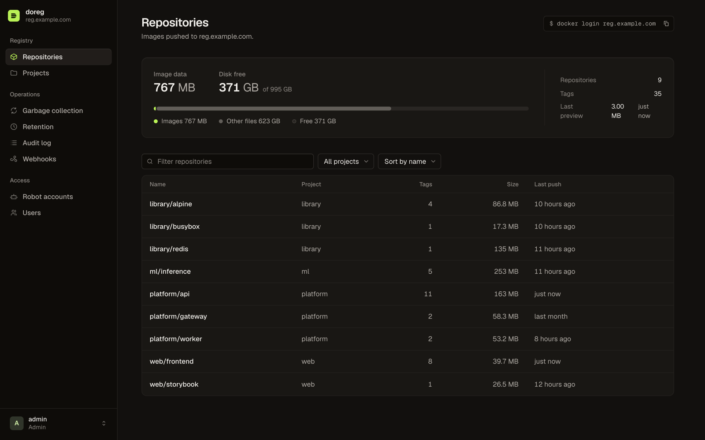
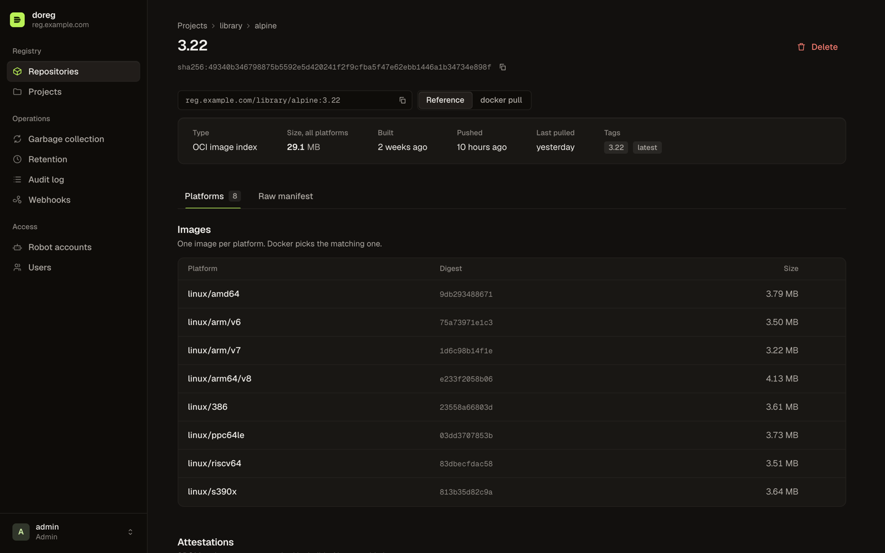
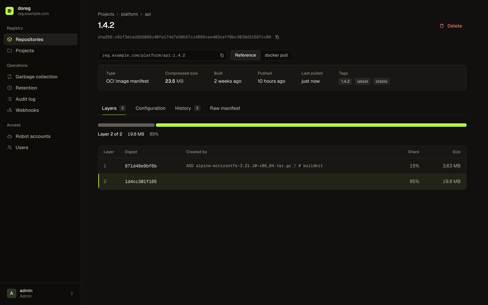
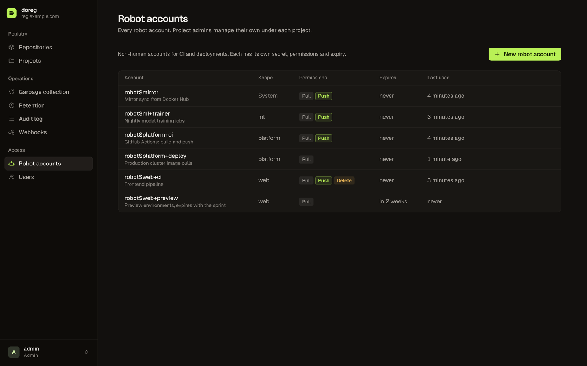
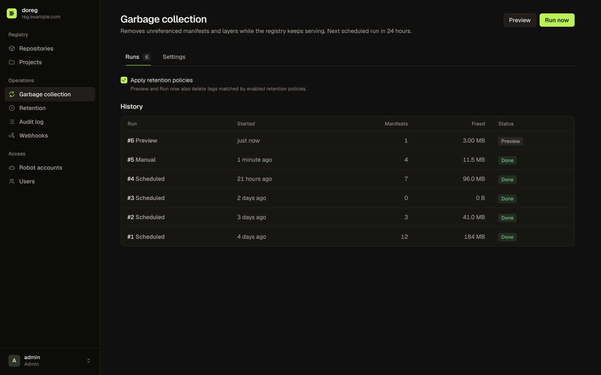
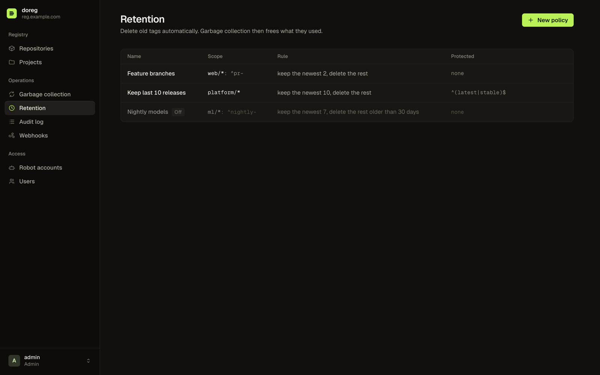
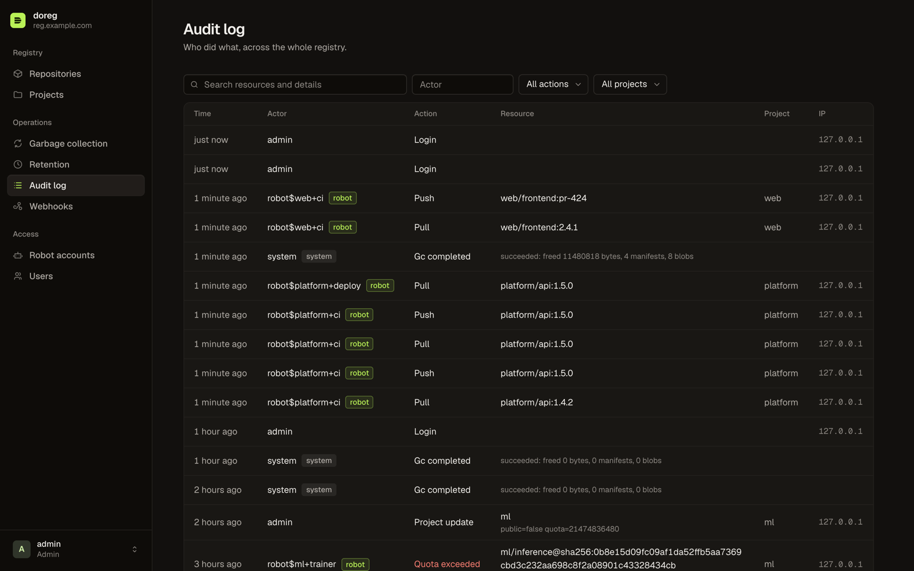

<div align="center">


# doreg

**The container registry you'll actually enjoy opening.**

Push, pull, browse, clean up. A self-hosted OCI registry with a proper web UI, SSO, robot accounts
and garbage collection that never asks you to go read-only. One binary, no extra services.

[](https://github.com/p-arndt/doreg/actions/workflows/ci.yml)
[](https://github.com/p-arndt/doreg/actions/workflows/release.yml)
[](#what-you-get)
[](go.mod)
[](LICENSE)

[Quick start](#-quick-start) · [What you get](#what-you-get) · [Access](#-projects-robots-and-sso) · [Storage](#-storage) · [Webhooks](#-webhooks) · [Garbage collection](#-garbage-collection) · [Migrating](#-migrating-from-registry2) · [Development](#%EF%B8%8F-development)

<br />



</div>

<br />

`registry:2` stores images fine, but it has no UI, users live in an htpasswd file, and cleaning up
means stopping it. Harbor fixes all that and brings a database server, Redis and half a dozen
containers along. **doreg is the middle ground:** what a team uses every day, in one process with one
data directory. Back up the directory and you've backed up the registry.

## 🚀 Quick start

**1. Run it.**

```sh
docker run -d --name doreg -p 8080:8080 -v doreg-data:/data \
  -e DOREG_ADMIN_PASSWORD='choose-a-long-password' ghcr.io/p-arndt/doreg:latest
```

Or with Docker Compose:

```yaml
services:
  doreg:
    image: ghcr.io/p-arndt/doreg:latest
    restart: unless-stopped
    environment:
      DOREG_ADMIN_PASSWORD: ${DOREG_ADMIN_PASSWORD:?set DOREG_ADMIN_PASSWORD}
    volumes:
      - doreg-data:/data
    ports:
      - "8080:8080"

volumes:
  doreg-data:
```

```sh
DOREG_ADMIN_PASSWORD='choose-a-long-password' docker compose up -d
```

[`deploy/compose.yaml`](deploy/compose.yaml) has the full version with Traefik and SSO options;
[`deploy/compose.s3.yaml`](deploy/compose.s3.yaml) adds a bundled RustFS for S3 blob storage;
[`deploy/compose.postgres.yaml`](deploy/compose.postgres.yaml) keeps the metadata in a bundled PostgreSQL.

**2. Push something.**

```sh
docker login reg.example.com
docker tag my-app reg.example.com/my-app:1.0
docker push reg.example.com/my-app:1.0
```

**3. Open `https://reg.example.com`** and look around.

> [!TIP]
> Put it behind a TLS-terminating proxy (Traefik, Caddy, nginx): docker only sends credentials over
> HTTPS, except to `localhost`. [`deploy/compose.yaml`](deploy/compose.yaml) is a complete Traefik example.
> Raise the proxy's read timeout too, since big layers take longer than 60 seconds.

## What you get

|  |  |
|---|---|
| 📦 **Speaks OCI 1.1** | Passes the official conformance suite. docker, buildx (multi-arch, SBOM and provenance), containerd, podman, crane and oras all just work. Manifests are served byte for byte as pushed. |
| 🧹 **Online garbage collection** | Untagged manifests and orphaned layers go away while pushes and pulls keep running. Preview any run first: same code path, rolled back. |
| ⏳ **Retention policies** | Keep the newest N, drop tags older than X days, per repository glob, with protected tags. Recently pulled digests survive, so pinned deployments stay safe. |
| 🔐 **Projects and roles** | read, write and admin per project, for users or OIDC groups. Public projects and storage quotas. |
| 🤖 **Robot accounts** | Credentials for CI: pull by default, push and delete if you say so, with expiry and secret rotation. |
| 🪪 **Single sign-on** | Any OpenID Connect provider. `doreg login` logs docker in through the browser, no secret copying. |
| 🔔 **Webhooks and audit log** | Signed, retried webhooks for pushes, pulls, deletes, quota hits and GC runs. Every change is in the audit log. |
| 🚚 **Import** | Pull every repository of an existing registry (registry:2, Harbor, GHCR, ...) in from the UI. Digests stay the same, reruns skip what's done. |
| 🪶 **Small** | One static binary or a 22 MB distroless image. SQLite (or PostgreSQL) plus blobs on disk or in any S3 bucket. |

<table>
  <tr>
    <td width="33%"></td>
    <td width="33%"></td>
    <td width="33%"></td>
  </tr>
  <tr>
    <td width="33%"></td>
    <td width="33%"></td>
    <td width="33%"></td>
  </tr>
</table>

## 🔐 Projects, robots and SSO

A repository belongs to the project named by its first path segment: `team/api` lives in `team`,
names without a slash in `library`.

| Role    | Pull | Push, delete tags and manifests | Members, robots, webhooks, repository settings |
|---------|------|---------------------------------|------------------------------------------------|
| `read`  | yes  |                                 |                                                |
| `write` | yes  | yes                             |                                                |
| `admin` | yes  | yes                             | yes                                            |

- Members are local users or OIDC groups; a user gets the highest role they hold either way.
- Public projects allow anonymous pulls; a single repository can be made public too. Quotas (bytes, set by system admins) reject pushes that would exceed them.
- With `DOREG_PUBLIC_BROWSE=true`, visitors who are not signed in see the public repositories in the web UI (list, tags, manifests) and a sign-in button. Everything else stays behind the login. It is off by default, because the list reveals repository names that anonymous pulls alone do not.
- System admins can push anywhere, and a push to a new project creates it. Everyone else needs a membership.
- System users are either `admin` or `user`; users only see what their memberships give them. Accounts with the old global `read` or `write` role became `user` on upgrade and need memberships.

```sh
echo 'secret-password' | doreg user add --role user ci
```

**Robot accounts** are named `robot$<project>+<name>` (or `robot$<name>` for system robots, which
work in every project). Their secret is shown once, on creation or rotation. Quote the `$` in shells:

```sh
echo "$ROBOT_SECRET" | docker login reg.example.com -u 'robot$team+ci' --password-stdin
```

**Single sign-on** turns on when `OIDC_ISSUER` is set (authorization code flow with PKCE, works with
Authentik, Keycloak and friends). SSO users log docker in with one command:

```sh
doreg login reg.example.com
```

It shows a code, opens the browser, and runs `docker login` once you approve. The token lasts 90 days
and can be revoked on the account page. `--print` hands out username and token for CI instead;
machines without a browser can use a CLI secret from the account page as the password.

### SSO settings

| Variable | Default | Meaning |
|----------|---------|---------|
| `OIDC_ISSUER` | | Issuer URL, the base URL that serves `/.well-known/openid-configuration`. Setting it enables SSO. |
| `OIDC_CLIENT_ID` | | Client ID (required with issuer). |
| `OIDC_CLIENT_SECRET` | | Client secret (required with issuer). |
| `OIDC_REDIRECT_URI` | | `<public url>/api/auth/oidc/callback`, e.g. `https://reg.example.com/api/auth/oidc/callback` (required with issuer). |
| `OIDC_PROVIDER_NAME` | `Single sign-on` | Label of the login button. |
| `OIDC_SCOPES` | `openid,profile,email` | Scopes, comma- or space-separated. |
| `OIDC_USERNAME_CLAIM` | `preferred_username` | Claim used as the doreg username. |
| `OIDC_GROUPS_CLAIM` | empty | Claim holding group names. Empty: the `groups`, `roles` and `realm_access.roles` claims are all read and merged. |
| `OIDC_ADMIN_ROLE` | empty | A group or role that makes its members system admins. |
| `OIDC_ADMIN_EMAILS` | empty | Comma-separated emails that make their owners system admins, only if the provider marks the email as verified. |

#### Who becomes admin

1. If `OIDC_ADMIN_ROLE` or `OIDC_ADMIN_EMAILS` is set, they decide at every SSO login: users matching either become admins, everyone else is a normal user. Removing the role at the provider (or the email from the list) demotes at the next login.
2. If neither is set, roles are managed in doreg (Users page). While the instance has no admin at all, the first person who signs in via SSO becomes admin; doreg logs a warning and an audit entry. Only accounts of your identity provider can sign in, so set one of the variables before opening a provider to the public.

`DOREG_ADMIN_PASSWORD` is optional with SSO; keep a local admin only as a fallback for when the provider is down.

Setup: create a confidential OpenID client with `OIDC_REDIRECT_URI` as redirect URI, make sure the ID
token carries groups or roles (many providers need a groups scope or mapper), set the variables and
restart. The first SSO login creates the account; if the name is taken by a local account the SSO user
gets a suffix (`alice-2`), local accounts are never taken over.

## 💾 Storage

Everything lives in the data directory (`DOREG_DATA`, `/data` in the image) unless `S3_BUCKET` is set;
then blobs go to the bucket, which is created on startup if missing. Upload sessions stay on local disk,
so keep the volume either way.

Metadata lives in SQLite (`doreg.db` in the data directory) unless `DATABASE_URL` points to PostgreSQL,
for example `postgres://doreg:secret@db:5432/doreg?sslmode=disable`. The schema is created on start. Run
one doreg per database: digest locks and the GC scheduler live in the process. There is no migration
between the two; pick one when setting up.

### Settings

| Variable | Default | Meaning |
|----------|---------|---------|
| `DOREG_DATA` | `./data` | Data directory: SQLite metadata, upload sessions and, without S3, the blobs. |
| `DATABASE_URL` | | `postgres://…` URL: keep metadata in PostgreSQL instead of SQLite. |
| `DOREG_ADDR` | `:8080` | Listen address. |
| `DOREG_ADMIN_USER` | `admin` | With `DOREG_ADMIN_PASSWORD`: the admin created on start if no users exist. |
| `DOREG_ADMIN_PASSWORD` | | Password of that admin. Optional with SSO. |
| `DOREG_WEBHOOK_ALLOW_PRIVATE` | `false` | Allow webhook URLs on private networks. |
| `DOREG_PUBLIC_BROWSE` | `false` | Show public repositories in the web UI without signing in. |

| Variable | Default | Meaning |
|----------|---------|---------|
| `S3_BUCKET` | | Bucket for blobs. Setting it enables S3 storage. |
| `S3_ENDPOINT` | | Endpoint URL for MinIO or minibucket, e.g. `http://localhost:9000`. For AWS use `https://s3.<region>.amazonaws.com`. |
| `S3_REGION` | `us-east-1` | Region. |
| `S3_ACCESS_KEY_ID` | | Access key. |
| `S3_SECRET_ACCESS_KEY` | | Secret key. |
| `S3_FORCE_PATH_STYLE` | | Path-style addressing: `true` for MinIO and minibucket, `false` for AWS. |
| `S3_PREFIX` | empty | Optional key prefix inside the bucket. |

## 🔔 Webhooks

Project admins add webhooks to their project, system admins add ones that hear every project. Pick
from `push`, `pull`, `delete_tag`, `delete_manifest`, `delete_repository`, `quota_exceeded` and
`gc_completed`; the test button sends a `ping` and every delivery attempt is listed.

Deliveries are JSON `POST`s, signed with HMAC-SHA256 in `X-Doreg-Signature-256` when a secret is set,
and retried after 5 and 30 seconds. Private, loopback and link-local targets are refused unless
`DOREG_WEBHOOK_ALLOW_PRIVATE=true`, so project admins can't poke at internal services.

### Payload and signature

Headers: `X-Doreg-Event` (the event type), `X-Doreg-Attempt` (1 to 3) and `X-Doreg-Signature-256`
(`sha256=<hex>`). Anything other than a 2xx counts as failed; redirects are not followed.
`occurredAt` is a Unix timestamp, `operatorKind` is `user`, `robot` or `anonymous`.

```json
{
  "type": "push",
  "occurredAt": 1763280000,
  "operator": "ci",
  "operatorKind": "robot",
  "project": "team",
  "repository": "team/api",
  "tag": "1.0",
  "digest": "sha256:9f2c4e7b1a...",
  "resourceUrl": "reg.example.com/team/api:1.0"
}
```

Verify the signature in Go, over the raw body:

```go
body, _ := io.ReadAll(r.Body)
mac := hmac.New(sha256.New, []byte(secret))
mac.Write(body)
want := "sha256=" + hex.EncodeToString(mac.Sum(nil))
valid := hmac.Equal([]byte(want), []byte(r.Header.Get("X-Doreg-Signature-256")))
```

## 🧹 Garbage collection

Runs every 24 hours by default. Interval, grace period and retention policies live in the UI, and
every run can be previewed before it deletes anything. Or from the shell:

```sh
doreg gc --dry-run --retention
```

### How GC stays safe online

Mark and sweep of metadata run in one write transaction; a manifest push checks its references in its own write transaction, and doreg funnels all writes through one database connection (on PostgreSQL too), so the two are serialised. Content younger than the grace period (default 60 minutes) is never collected, which covers clients between uploading layers and pushing the manifest. Files are deleted under a per-digest lock after their database row is gone, so a concurrent upload of the same layer never loses its file.

## 🚚 Migrating from registry:2

Open **Import** in the UI (admins only), enter the old registry's URL and, if it needs one, its login,
hit **Preview** to see what will be copied, then **Start import**. doreg pulls every tag over the
registry API and stores it like a push:

- Manifests are copied byte for byte, so digests don't change and `image@sha256:...` references keep working. Multi-arch indexes come along with all their platforms.
- Logins: htpasswd (Basic) and token auth (`auth: token`, Docker Hub, GHCR) both work. The password is used for that one import and never stored. A self-signed certificate needs **Skip TLS certificate check**.
- Narrow it down with names or patterns like `team/*`. Registries without `/v2/_catalog` (Docker Hub) need plain repository names.
- Tags already up to date are skipped and shared layers are transferred once, so an interrupted import is simply started again.
- Pushes land in the audit log under the admin who started the import but fire **no webhooks**, so old images don't trigger deployments. Names without a slash land in the `library` project.
- Only tagged images are copied; untagged manifests and referrers without a tag (e.g. OCI 1.1 signatures) stay behind.

The same works from any machine with the CLI, against a running doreg:

```sh
export DOREG_FROM_PASSWORD=...   # old registry
export DOREG_TO_PASSWORD=...     # doreg admin password or CLI secret
doreg import --from https://old.example.com:5000 --from-user migrate \
             --to https://registry.example.com --to-user admin --dry-run
```

Drop `--dry-run` to copy. `--repo 'team/*'` (repeatable) limits it, `--from-insecure` skips the TLS check, and `--concurrency` sets how many tags are copied at once (default 4). Run with the doreg image instead of a local binary: `docker run --rm -e DOREG_FROM_PASSWORD -e DOREG_TO_PASSWORD <doreg-image> import ...`.

## 🛠️ Development

```sh
cp .env.example .env
docker compose up -d   # minisuite (OIDC, S3, mail) and the push proxy
just dev               # API on localhost:8080 plus the UI with hot reload on localhost:5173
```

Open http://localhost:5173: Vite serves the UI with hot reload and proxies `/api` and `/v2` to the API, and the dev SSO login returns there too. `just dev-api` runs only the API; `just web-build` embeds the UI into the binary.

`compose.yaml` holds only the dependencies, [minisuite](https://github.com/p-arndt/minisuite); doreg runs on the host. Sign in with SSO as `alice` (admin) or `bob` (normal user); the passwords are the same as the usernames. The overview page at localhost:9900 lists all URLs.

Docker Desktop's daemon cannot reach a process on the host's localhost, so push and pull through the proxy on port 5050:

```sh
docker login localhost:5050 -u alice   # password: CLI secret from the account page
docker push localhost:5050/team/api:dev
```

`go run ./cmd/doreg login ...` runs the CLI without installing it, for example `go run ./cmd/doreg login --docker-host localhost:5050 localhost:5173`.

```sh
just          # list recipes
just ci       # gofmt, vet, tests, UI check, lint and tests
just test-postgres  # Go tests against the compose PostgreSQL (docker compose up -d postgres)
just release  # cut a release (stamp)
```

## License

[MIT](LICENSE)
